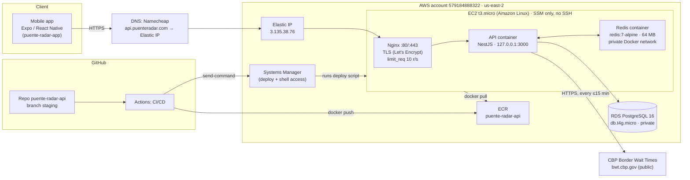
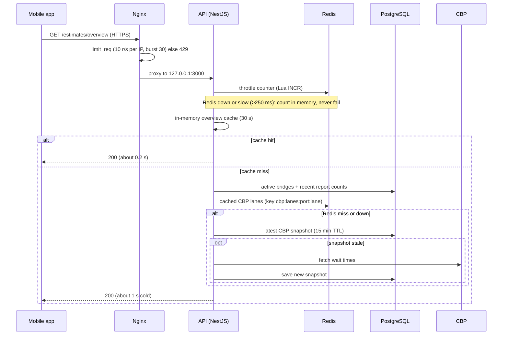
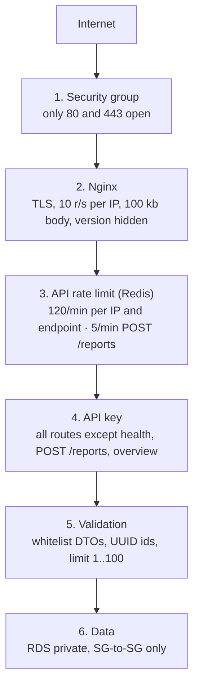
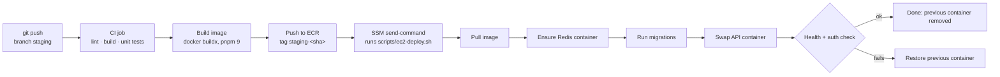

# Puente Radar: architecture map

How the pieces fit together today (staging, one environment, 2026-11-11). Diagrams are
Mermaid; GitHub and most Markdown editors render them.

Related docs: [`deployment-workflow.md`](deployment-workflow.md) (CI/CD in detail),
[`api-consumption.md`](api-consumption.md) (endpoints and contract),
[`security-audit.md`](security-audit.md), [`auth-plan.md`](auth-plan.md) (planned login).

## 1. The whole picture



## 2. Components

| Piece               | What it is                                                                                                                    | Notes                                                                                                                                                  |
| ------------------- | ----------------------------------------------------------------------------------------------------------------------------- | ------------------------------------------------------------------------------------------------------------------------------------------------------ |
| **Mobile app**      | Expo / React Native, repo `puente-radar-app`                                                                                  | Calls the public API; shows Home, bridge detail, report form                                                                                           |
| **DNS**             | Namecheap (`dns1/dns2.registrar-servers.com`)                                                                                 | `api.puenteradar.com` A record → Elastic IP. Not Route 53                                                                                              |
| **Elastic IP**      | `3.135.38.76`                                                                                                                 | Fixed address attached to the EC2 instance                                                                                                             |
| **EC2**             | `t3.micro`, 913 MB RAM, 20 GB gp3, `us-east-2a`                                                                               | No SSH key; access only through SSM Session Manager. Runs Nginx, the API and Redis                                                                     |
| **Nginx**           | Reverse proxy and TLS termination                                                                                             | Certbot certificate (renews automatically, expires 2027-02-07). Config in `/etc/nginx/conf.d/`; owned pieces in `infra/nginx/`                         |
| **API container**   | NestJS 11, Node 20, runs as non-root `node`                                                                                   | Bound to `127.0.0.1:3000`, reachable only through Nginx. Image from ECR                                                                                |
| **Redis container** | `redis:7-alpine`, `maxmemory 64mb`, `volatile-lru`, no persistence                                                            | Started by the deploy script on Docker network `puente-radar-net`; no published port. Holds rate-limit counters and the CBP cache. Both are disposable |
| **RDS**             | PostgreSQL 16.15, `db.t4g.micro`, 20 GB gp3, encrypted, 1-day backups, single AZ                                              | Not publicly accessible. Inbound 5432 only from the EC2 security group                                                                                 |
| **ECR**             | Repository `puente-radar-api`, scan on push                                                                                   | Lifecycle keeps the last 5 images                                                                                                                      |
| **SSM**             | Systems Manager                                                                                                               | The pipeline sends the deploy command; you open a shell here                                                                                           |
| **CBP**             | `https://bwt.cbp.gov/api/waittimes`                                                                                           | Public source of official wait times. Timeout 4 s, fresh for 15 min                                                                                    |
| **GitHub Actions**  | One workflow, `.github/workflows/ci-cd.yml`                                                                                   | Lint, build, test, then build image, push to ECR and deploy                                                                                            |
| **IAM**             | `puente-radar-ec2-role` (instance profile), user `github-actions-puente-radar` (pipeline), user `cli-admin` (temporary admin) | `cli-admin` should be deactivated; see section 9                                                                                                       |
| **Budgets**         | `puente-radar-gross-usage` (30 USD) and `puente-radar-net-charges` (1 USD)                                                    | Email alerts. Free credits run until about March 2027                                                                                                  |

## 3. What happens on a request

Example: the Home screen asks for `GET /estimates/overview`.



Order inside the API for every request: **rate limiter, then API-key guard, then
validation pipes, then the controller**. The limiter runs first on purpose, so wrong keys
are throttled too.

## 4. Protection layers



Rate-limit counters are per IP **and per endpoint**. That is what lets `POST /reports` have
its own stricter budget.

## 5. Data

PostgreSQL tables (TypeORM migrations in `src/database/migrations/`):

| Table                  | Purpose                                                                                                              |
| ---------------------- | -------------------------------------------------------------------------------------------------------------------- |
| `bridges`              | The 6 bridges: name, slug, short name, coordinates, opening hours, CBP port                                          |
| `reports`              | Citizen reports (anonymous today). The server always stores them as `pending`                                        |
| `cbp_snapshots`        | Last good CBP fetch, used as a TTL cache and stale fallback                                                          |
| `estimate_adjustments` | Manual minute offsets per bridge and lane (`adjustmentMinutes`, `reason`, `isActive`) applied on top of the estimate |
| `cbp_collection_runs`  | Audit of the scheduled collector                                                                                     |

Redis keys (all disposable):

| Key                                       | Purpose                               |
| ----------------------------------------- | ------------------------------------- |
| `throttle:<policy>:<hash>` and `:blocked` | Rate-limit counters and block markers |
| `cbp:lanes:<port>:<lane>`                 | CBP lane data, short TTL              |

There is also a scheduled job (`@Cron` every 15 minutes) that stores historical CBP data. It
is switched off by default (`HISTORICAL_COLLECTION_ENABLED=false`).

## 6. Delivery pipeline



- A push to `staging` deploys to the only environment that exists. `main` is reserved for
  a future production environment.
- A failed CI run stops everything: nothing is built or deployed (this happened once on
  `684847e`).
- Migrations run **before** the new container starts, so a bad migration leaves the old
  API running.

## 7. Where configuration and secrets live

| What                                                                              | Where                                                                     | Who can read it                 |
| --------------------------------------------------------------------------------- | ------------------------------------------------------------------------- | ------------------------------- |
| API environment (DB credentials, `ADMIN_API_KEY`, `CORS_ORIGIN`, throttle limits) | `/home/ec2-user/puente-radar.env` on the EC2, mode 600                    | Root and `ec2-user` through SSM |
| `REDIS_URL`                                                                       | Not in the file; the deploy script sets `redis://puente-radar-redis:6379` | Deploy script                   |
| Pipeline AWS keys, region, repository name                                        | GitHub repository secrets                                                 | GitHub Actions                  |
| TLS certificate                                                                   | `/etc/letsencrypt/` on the EC2                                            | Root                            |
| Mobile app settings                                                               | `EXPO_PUBLIC_*` variables (public by design)                              | Anyone with the app             |

No AWS Secrets Manager or SSM Parameter Store is used. Anything in the mobile app bundle
is public, which is why the admin key never goes there and `GET /estimates/overview` is
public.

## 8. Operations cheat sheet

All commands use the `puente-radar` AWS profile and region `us-east-2`.

```bash
# Open a shell on the server (no SSH)
aws ssm start-session --target i-0ed0763fb9ba9e989

# On the server
docker ps                                   # api, redis
docker logs --tail 100 puente-radar-api     # API log
docker exec puente-radar-redis redis-cli ping
docker exec puente-radar-redis redis-cli --scan --pattern 'throttle:*' | head
sudo nginx -t && sudo systemctl reload nginx
sudo certbot renew --dry-run

# Quick health from anywhere
curl https://api.puenteradar.com/health
```

- **Rollback:** during a deploy the previous container is kept until the new one passes its
  health and auth checks; if it fails, the script restores it. After a successful deploy
  the old container is gone (its image stays on the server for up to 7 days and in ECR,
  last 5). To go back later, re-run the workflow on the older commit.
- **Reseed catalog data:** `docker run --rm --env-file /home/ec2-user/puente-radar.env <image> pnpm run seed`.
- **Rate-limit tuning:** edit `THROTTLE_LIMIT` / `THROTTLE_REPORTS_LIMIT` in the env file,
  then redeploy (or restart the API container).

## 9. Known limits and next steps

- **One instance, one environment.** No high availability: a reboot of the EC2 means a
  short outage. Fine for staging; production needs a plan.
- **Redis on the same small machine.** About 387 MB of RAM is free; Redis is capped at
  64 MB. If a second API instance ever exists, Redis must move off the box (ElastiCache or
  a separate host), since limits are shared through it.
- **No CDN or WAF.** If real attacks appear, put CloudFront in front of the public overview
  before anything heavier.
- **Rotate `ADMIN_API_KEY`** and deactivate the temporary `cli-admin` access key.
- **Develop environment:** planned, with Swagger on (`/api/docs`). Production and staging
  keep it off.
- **Login with Google/Facebook:** planned in `auth-plan.md`; reads stay public.
- **Cost watch:** credits end around March 2027; the budgets above email you before real
  charges appear.

## 10. Repositories and local layout

```
puente-radar/                  (not a git repo; workspace folder)
├── puente-radar-api/          NestJS API, infra/nginx, scripts, docs  → GitHub: puente-radar-api
├── puente-radar-app/          Expo app                                → separate repo
├── design/                    HTML design prototypes (local only)
└── odd/tasks/                 working notes per feature (local only)
```
